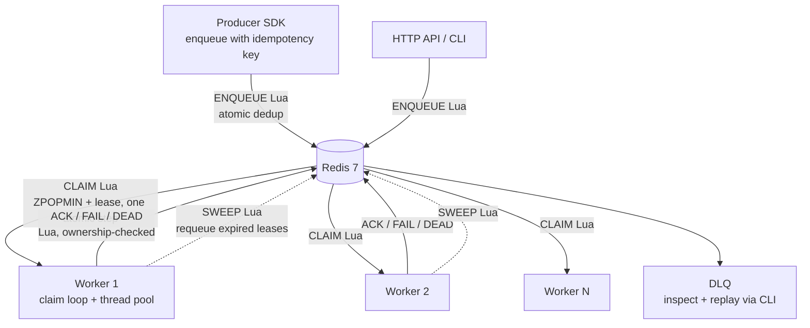
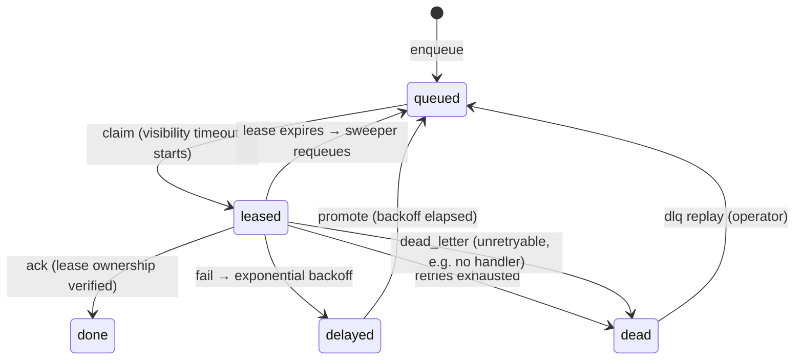

# TaskForge — a distributed task queue built from scratch

A real, working distributed task queue in pure Python on Redis — no Celery, no
framework magic. Priority queues, competing worker pools, atomic lease-based
claiming, idempotent producers, retries with backoff, a dead-letter queue,
per-tenant rate limiting, and measured benchmarks.

**Why this exists:** it proves distributed-systems literacy — delivery
semantics, idempotency, worker coordination — the exact failure modes product
companies hit (e.g. duplicate charges when a producer retries after a
timeout). "Understands queues beyond *just add Celery*."

## The 60-second demo

The highest-ROI story in this repo: a customer clicks **Pay** once, the
broker ack times out, the producer retries with the same idempotency key —
and the card is still charged exactly once.

```bash
# 5-minute setup
git clone <this-repo> && cd project-02-task-queue

# 1) Redis on localhost:6379 — pick ONE:
sudo apt install redis-server && sudo systemctl enable --now redis-server   # native
# docker compose up -d redis                                                # or Docker

# 2) Python deps (3.11+)
python3 -m venv .venv && .venv/bin/pip install -e . -r requirements-dev.txt

# the double-charge story, one command:
python demo/double_charge.py
```

Expected ending: `charges recorded: 1` — the duplicate submission was
suppressed atomically inside Redis, before any worker ever saw it.

For the full failure-injection show (SIGKILL a worker mid-job, watch the
lease expire and another worker recover it, then poison → DLQ → replay):

```bash
python demo/failure_scenario.py
```

## Architecture



Job lifecycle:



### Redis data model

| Key | Type | Purpose |
|---|---|---|
| `tf:queue` | ZSET | Ready jobs. Score = `enqueue_ms − priority·10¹³ + seq/1000`: strict priority order, FIFO within a level |
| `tf:delayed` | ZSET | Retry backoff / explicit delays. Score = run-at timestamp |
| `tf:leases` | ZSET | Active leases. Score = deadline (unix ms) |
| `tf:lease:{id}` | HASH | Lease owner (`worker_id`) + deadline |
| `tf:job:{id}` | HASH | Job JSON, attempts, status, last error |
| `tf:idem:{tenant}:{key}` | STRING | Idempotency key → job id (TTL 24h) |
| `tf:dlq` | LIST | Dead-job snapshots for inspection |
| `tf:rl:{tenant}` | HASH | Token-bucket state per tenant |
| `tf:metrics` | HASH | Counters: enqueued, claimed, acked, retried, dlq, lease_expired, idempotency_hits |
| `tf:latency` | LIST | Recent enqueue→ack samples (capped at 20k) |

Every state transition that must be atomic is a Lua script (`taskforge/lua.py`)
— claim, ack, fail, sweep, enqueue-dedup, rate-limit — because Redis runs a
script single-threaded. Each script documents the exact race it eliminates.

## Features

- **Priority queues** — 10 levels, strict ordering, FIFO within a level, exact
  even for same-millisecond enqueues (per-producer sequence tiebreak).
- **Competing consumers** — run any number of workers; atomic claim means a
  job is handed to exactly one. Graceful shutdown releases leases immediately.
- **Leases / visibility timeout** — per-job configurable; expired leases are
  swept and requeued (crash recovery, tested with real SIGKILL).
- **Idempotent producers** — same key → same job id, enforced atomically.
- **At-least-once delivery** — documented trade-offs in
  [`docs/delivery_semantics.md`](docs/delivery_semantics.md); effectively-once
  for money paths via idempotent handlers (demo proves it).
- **Retries** — exponential backoff `min(cap, base·2^attempt)` plus jitter
  (kills thundering-herd retries), then **DLQ** with inspect/replay CLI.
- **Per-tenant rate limiting** — token bucket in Lua; over-limit jobs are
  *deferred*, never dropped.
- **Observability** — structured JSON logs (`... | jq 'select(.event=="job_failed")'`),
  `taskforge stats`, `taskforge latency` (p50/p99).

## Producer SDK

```python
from taskforge import TaskForge

tf = TaskForge("redis://localhost:6379/0")

res = tf.enqueue(
    "charge_card",
    {"order_id": "order-123", "amount": 499},
    idempotency_key="order-123",   # retry-after-timeout safe
    priority=10,                   # 1 (low) .. 10 (high)
    tenant="shop",
    max_retries=3,
    lease_timeout_s=30,            # visibility timeout for this job
    delay_s=0,                     # schedule for later
)
print(res.job_id, res.duplicate)   # duplicate=True if the key was seen before

tf.get_job(res.job_id)             # status, attempts, result, last_error
tf.stats()                         # depths + counters
tf.dlq_list()                      # inspect poison jobs
tf.dlq_replay(job_id="...")        # or replay_all=True
tf.set_rate_limit("shop", capacity=100, refill_per_second=10)
job = tf.wait_for(res.job_id, timeout_s=30)   # block until done/dead
```

## Worker

```python
from taskforge import TaskForge, Worker, Registry

registry = Registry()

@registry.register("charge_card")
def charge_card(payload: dict):
    ...

Worker(TaskForge(), handlers=registry, concurrency=8).run()
```

Or via CLI: `taskforge worker --handlers-module demo.jobs --concurrency 8
--rate-limit shop:100:10`

## CLI reference

```
taskforge enqueue --fn charge_card --payload '{"order_id":"1"}' \
    --idempotency-key order-1 --priority 10 --tenant shop
taskforge worker --handlers-module demo.jobs --concurrency 8
taskforge stats
taskforge inspect <job_id>
taskforge dlq list [--limit 50]
taskforge dlq replay <job_id> | --all
taskforge latency
```

All commands accept `--redis-url` / `--namespace` (or `REDIS_URL` /
`TASKFORGE_NAMESPACE` env). See `.env.example` for every tunable.

## Benchmarks

Measured, not estimated. Same-host setup (app + Redis on one box), no-op
handler to isolate queue overhead, latency = enqueue→ack per job (includes
queue wait). Raw JSON in `benchmarks/results/`; reproduce with
`benchmarks/run.sh`.

| Benchmark | Config | Throughput | Latency |
|---|---|---|---|
| End-to-end sustained | 20k jobs, 2 workers × 8 threads | **974 jobs/s (3.51M/hour)** | saturated run — latency is queue wait, see below |
| End-to-end latency (unsaturated) | 2k jobs paced at 400 jobs/s, 2 workers × 8 threads | — | **p50 7ms, p99 21ms** |
| k6 HTTP enqueue path | 34k reqs, ≤40 VUs, `k6 run benchmarks/k6_producer.js` | **850 req/s**, 0% failed | p95 11.6ms |

Machine: 2 vCPU (AMD EPYC 9D25), Redis 7.0.15, Python 3.12. Load-test rows
measured 2026-10-15; raw JSON in `benchmarks/results/`. The k6 row was
measured 2026-10-14 on the same-class machine and was not re-run here (k6 is
not installed on this box) — re-run it yourself with `./benchmarks/run.sh --k6`.

**Methodology notes (read before quoting):** producers and workers ran as
threads in one Python process on the same host as Redis, so these are ceiling
numbers — expect lower over a network and higher with more Redis capacity.
Throughput scales sub-linearly with worker count here: each job costs ~3 Lua
round trips and this box has 2 vCPUs, so the claim loop + GIL become the
ceiling around ~1k jobs/s. One real optimization already applied: the
delayed-set promote was throttled from every-tick to 4×/s (+11% throughput).
Re-run on your hardware: `./benchmarks/run.sh` and `./benchmarks/run.sh --k6`.

## Live dashboard

A minimal single-page dashboard served by the demo HTTP API — real numbers
only, no simulation:

```bash
# terminal 1: a worker (it heartbeats every 5s so the dashboard can list it)
.venv/bin/python -m taskforge.cli worker --handlers-module demo.jobs --concurrency 4

# terminal 2: the API
DEMO_API_PORT=8080 .venv/bin/python benchmarks/demo_api.py

# open http://localhost:8080/dashboard
```

Shows queue depth total + per priority (exact, from ZSET score bands),
acked/s throughput, active leases, DLQ depth, enqueue→ack latency p50/p99,
worker liveness (a SIGKILLed worker shows as *down* after its heartbeat
expires), and a small form to enqueue a test job. Auto-refreshes every 3s
via `GET /api/stats`. Works with any namespace: set `TASKFORGE_NAMESPACE` on
both the worker and the API.

## Trade-offs (the interview cheat sheet)

- **At-least-once, not exactly-once.** Exactly-once is impossible in general;
  TaskForge pairs at-least-once delivery with idempotency on both edges
  (producer keys + idempotent handlers) for effectively-once money paths.
  Full write-up: [`docs/delivery_semantics.md`](docs/delivery_semantics.md).
- **Lease vs heartbeat.** Leases are dumber than heartbeats but have no
  failure detector to tune and no "worker is alive but stuck" ambiguity — a
  stuck worker's jobs *should* be requeued. Cost: handler time must stay
  under the visibility timeout (same rule as SQS).
- **Lua over WATCH/MULTI.** Single-threaded atomicity, no client-side retry
  storms under contention, and the race being eliminated is documented in
  each script.
- **Deferral over rejection for rate limits.** An over-limit job waits 1s and
  retries; nothing is ever dropped by the limiter.
- **No result backend / no cron.** Out of scope on purpose: results live on
  the job hash; recurring schedules belong in a scheduler, not a queue.
  (Both are listed as follow-ups below.)

## Testing

```bash
pip install -r requirements-dev.txt
pytest tests/ -q
```

22 tests, all against real Redis: priority ordering, idempotency under
retry-after-timeout (including post-completion), retry→DLQ path, DLQ replay,
lease expiry/recovery, ack-after-expiry rejection, per-tenant rate limits,
deferral, worker-heartbeat liveness + per-priority depth, and a SIGKILL
fault-injection test that kills a worker mid-job and proves another worker
recovers it.

## Project structure

```
taskforge/          # the library
  client.py         # producer SDK + admin API
  worker.py         # competing-consumer pool, graceful shutdown
  lua.py            # atomic scripts (claim/ack/fail/sweep/dedup/...)
  handlers.py       # fn-name -> callable registry
  config.py         # env-based tuning
  metrics.py        # latency percentiles
  logging_config.py # JSON log formatter
  cli.py            # argparse CLI
demo/
  jobs.py             # charge_card (idempotent), email, flaky, poison, slow
  double_charge.py    # one-command duplicate-suppression story
  failure_scenario.py # SIGKILL recovery + DLQ replay, narrated
benchmarks/
  load_test.py      # throughput/latency harness -> results/*.json (--enqueue-rate for paced runs)
  demo_api.py       # stdlib HTTP API for k6 + the live dashboard (/, /dashboard, /api/stats)
  dashboard.html    # single-page live dashboard (depth, throughput, workers, DLQ)
  k6_producer.js    # k6 producer benchmark
  run.sh            # ./run.sh [--k6]
docs/
  delivery_semantics.md  # at-most vs at-least vs exactly-once
```

## Resume bullets (fill in your measured numbers)

```text
- Built a distributed task queue from scratch in Python on Redis sustaining
  [X] jobs/hour with p99 enqueue-to-ack latency of [Y]ms (measured with k6 +
  a custom load harness); priority queues, atomic lease-based claiming, and
  competing-consumer worker pools with graceful shutdown.
- Designed at-least-once delivery with Lua-atomic idempotency keys so
  producer retries after broker timeouts never duplicate jobs; proved crash
  recovery with a SIGKILL fault-injection test (orphaned lease → requeue →
  completion) and documented the at-most/at-least/exactly-once trade-offs.
- Implemented exponential backoff with jitter, a dead-letter queue with
  inspect/replay CLI, and per-tenant token-bucket rate limiting (defer, never
  drop); shipped with structured JSON logging, latency percentiles, Docker
  Compose, and GitHub Actions CI (22 tests).
```

Replace `[X]`/`[Y]` with your numbers from `./benchmarks/run.sh` on your machine.

## Follow-ups (deliberately not built)

Delayed/recurring (cron-like) schedules, a result backend with pub/sub
notification, Redis Cluster / Sentinel support, OpenTelemetry tracing. Each
is a clean, well-scoped extension — good "what would you add next?"
interview material.
